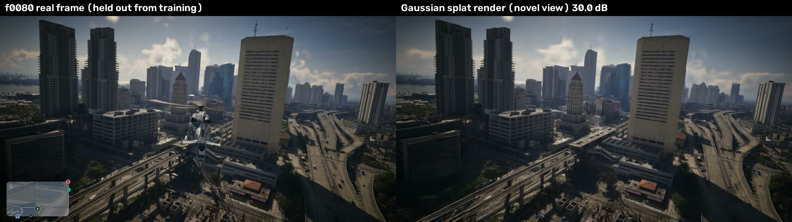
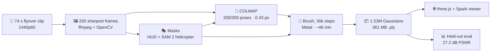
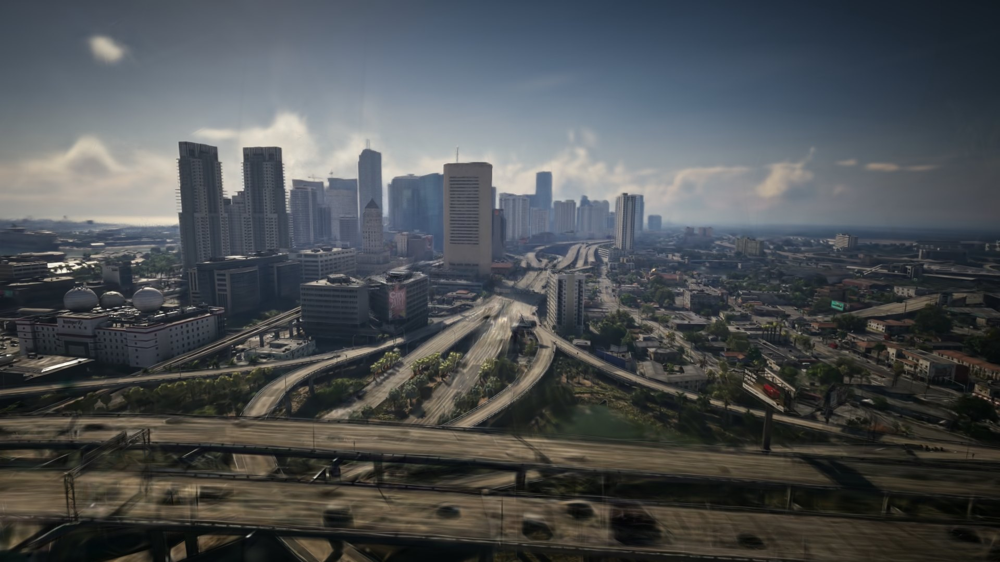
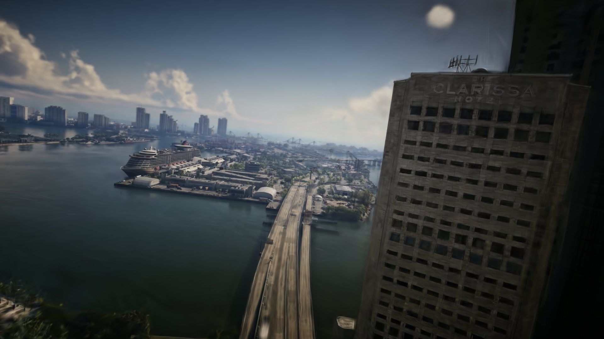
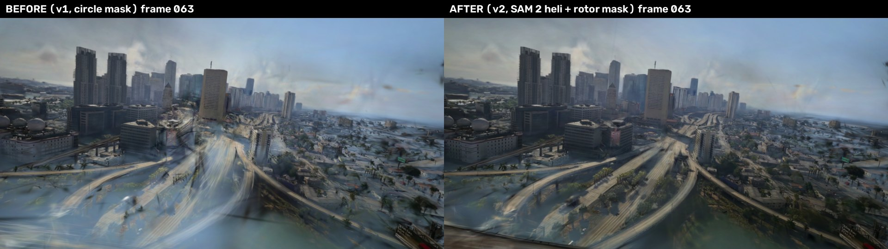

# Gaussian splat from a helicopter flyover: research notes

A one-day research spike (2026-11-22): **can you rebuild GTA VI's downtown Vice City in 3D from a single YouTube helicopter flyover?** It uses Gaussian splatting, entirely local on a Mac.

**Short answer:** the pipeline works and novel views near the flight path look real (**27.2 dB PSNR on held-out frames**). But one forward camera pass can't produce a scene you can freely explore: the far sides of buildings were never filmed. The project stopped after the go/no-go spike. This repo keeps everything learned for future projects with multi-angle footage.



## Pipeline at a glance



## Results

| | |
| --- | --- |
| Footage | 74 s of one chase-cam pass, ≈ 4.4 km corridor through downtown and the bay |
| Poses | 200/200 frames registered, 78k sparse points, 0.43 px reprojection error |
| Final splat | 1,527,578 Gaussians, 361 MB raw `.ply` (≈ 80 MB per km of corridor) |
| Quality (20 held-out frames) | 27.2 dB PSNR / 0.878 SSIM (v1 with naive masks: 24.6 dB) |
| Compute | ≈ 1.6 h GPU total on an Apple M5 Pro, $0 |

| | |
| --- | --- |
|  |  |

**Two fixes that mattered most:**
1. **SAM 2 helicopter masks** instead of a fixed circle removed the rotor-blade shards and the centre smear: **+2.7 dB**.
   
2. **Viewer settings:** Spark's default `maxPixelRadius: 512` clipped the sky and background splats. Raising it to 4096 took the viewer from 19.0 to 23.7 dB.

## Documentation

| Doc | What's in it |
| --- | --- |
| [docs/knowledge-base.md](docs/knowledge-base.md) | **Start here.** Concepts as Q&A (COLMAP, training steps, Gaussians vs points, `.ply` format, splats vs meshes), step-by-step build, timings and compute, the propeller problem and fixes, evaluation, ecosystem, operational lessons. Mermaid diagrams throughout |
| [docs/results-and-sizes.md](docs/results-and-sizes.md) | Metrics, file sizes for a dense downtown section, rules of thumb, what worked, why we stopped |
| [docs/pipeline-runbook.md](docs/pipeline-runbook.md) | Exact commands for every step, with timings |
| [docs/scaling-and-tooling.md](docs/scaling-and-tooling.md) | Brush vs gsplat, Colab via MCP, full-flight estimates, meshes, web delivery, formats, tool list |
| [docs/next-capture-guide.md](docs/next-capture-guide.md) | How to film footage that gives an explorable scene (orbits, grids, no HUD or vehicle) |
| [docs/research-log.md](docs/research-log.md) | The original phased plan and the dated decision log |

## Repository layout

```
docs/              knowledge base, results, runbook, scaling, capture guide, research log
media/
  hero/            best held-out renders + real-vs-render pairs (blog-ready)
  masks/           v1 circle vs v2 SAM 2 overlays, failed attempt, before/after SAM 2
  eval/            real vs Brush vs Spark sheet, all 20 held-out Brush renders
  offpath/         renders 20–50 m off the flight path, v1 vs v2 sheets
  viewer/          viewer before/after (masks + Spark settings)
  pipeline/        source frame and early preview frames
script_examples/   working scripts (frames, poses, SAM 2 masks, viewer, eval) + 2 failed approaches
data/              held-out metrics, v1-vs-v2 metrics, camera poses, COLMAP camera + stats, shot lists
```

**Not included (deleted on purpose):** `.ply` splats (≈1.8 GB), source video, the 200 frames, the COLMAP database, the SAM 2 checkpoint and the Python environments. Sizes are recorded in [results-and-sizes.md](docs/results-and-sizes.md); the [runbook](docs/pipeline-runbook.md) recreates everything.

## Stack
COLMAP 4.2.1 · Brush 0.3.0 (Burn/wgpu, Metal) · SAM 2.1 base+ (PyTorch 2.15, MPS) · ffmpeg 9 · OpenCV · three.js 0.186 + Spark 2.3 · puppeteer-core · Apple M5 Pro, 64 GB

## Credits and rights
- Source footage: "How BIG Is the GTA 6 Map? I Flew Across It in a Helicopter!" by **GameV** on YouTube (2:30–3:44), PS5 Pro gameplay. *Grand Theft Auto VI* is © Rockstar Games.
- All images in `media/` are frames or renders derived from that footage, used here for non-commercial research and commentary. No splat or model files are distributed.
