# Gaussian splatting knowledge base

Concepts, pipeline, timings, compute, failures and fixes from reconstructing a GTA VI downtown corridor from one helicopter flyover video (2026-11-22). It's written as Q&A and step-by-step notes, so it can be reused for later projects and blog posts.

- Outcome, metrics and sizes: [results-and-sizes.md](results-and-sizes.md)
- Exact commands to reproduce: [pipeline-runbook.md](pipeline-runbook.md)
- Original plan and decision log: [research-log.md](research-log.md)
- Scaling up (cloud GPUs, trainers, meshes): [scaling-and-tooling.md](scaling-and-tooling.md)
- Capturing better footage next time: [next-capture-guide.md](next-capture-guide.md)
- Scripts: [`../script_examples/`](../script_examples/) · Images: [`../media/`](../media/)

---

## 1. The big picture

**Gaussian splatting** turns ordinary photos or video of a place into a 3D scene you can fly through. The scene isn't made of triangles. It's made of about a million small, soft, coloured, semi-transparent blobs (3D Gaussians) that blend together into a photoreal image from any nearby viewpoint.

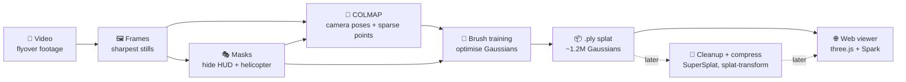

Three ideas cover the whole process:
1. **Where was the camera?** Structure-from-Motion (COLMAP) works this out from the images alone.
2. **What does the world look like?** Training adjusts millions of Gaussians until renders from those camera positions match the real frames.
3. **Show it.** A splat renderer draws the Gaussians in real time in the browser.

---

## 2. Concepts (Q&A)

### What is COLMAP?
COLMAP is an open-source **Structure-from-Motion (SfM)** tool. Given many photos of the same place, it works out **where each camera was** and **what the 3D scene looks like**.

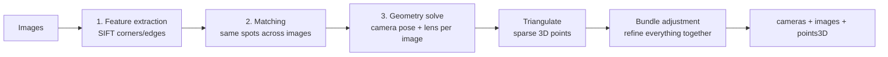

- We used the **sequential matcher**, which compares each frame with its 15 neighbours. That suits video, because frames come in order.
- We used COLMAP 4's **global mapper** (formerly GLOMAP), which solves all cameras at once. It's fast and robust.
- **Reprojection error**: project the 3D points back into the images and measure how far they land from the real feature. Ours was 0.43 px, which is excellent.
- COLMAP does **not** create the splat. It provides the poses and seed points that make training possible.

### How does training work? What does "10k" mean?
The 10k is the number of **training steps**, not Gaussians. Each step does this:

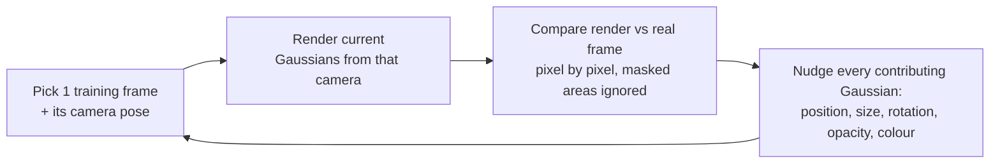

- 200 frames, with every 10th held out for evaluation, leaves **180 training frames**. 30,000 steps ÷ 180 means each frame is seen **about 165 times**.
- Snapshots are written at 10k, 20k and 30k steps so progress can be checked. 10k is just a checkpoint.

### Where do the Gaussians come from? (78k → 1.19M)
- **Start:** one Gaussian per COLMAP point, **about 78k**.
- **Densify:** Gaussians with large errors get **cloned** (small ones in under-detailed areas) or **split** (big blurry ones).
- **Prune:** nearly transparent or huge stray ones get deleted.
- **Growth stops** partway through, at about 20k steps in Brush. After that, the remaining steps only refine.

| Snapshot | Gaussians | File size |
| --- | --- | --- |
| v1 at 10k | 698,705 | 165 MB |
| v1 at 20k | 1,187,446 | 280 MB |
| v1 at 30k | 1,187,446 (growth stopped) | 280 MB |
| v2 at 10k (SAM masks) | 859,142 | 203 MB |
| v2 at 20k | 1,527,578 | 361 MB |
| v2 at 30k | 1,527,578 (growth stopped) | 361 MB |

v2 has about 29% more Gaussians than v1, because the tighter masks let more of the ground reach training. Steps also run slower with more Gaussians: v2 took 46 min vs 37 min for v1.

### "Points" vs Gaussians: are 1M+ points 1M+ Gaussians?
Yes. In a splat `.ply`, every vertex is one Gaussian. "Points" means two different things in this pipeline, though:

| | Count | What it is |
| --- | --- | --- |
| COLMAP points | ~78k | Sparse dots triangulated from feature matches. Position and colour only, no size or shape. |
| Splat Gaussians | ~1.19M | Soft, coloured, semi-transparent ellipsoids with size, rotation and opacity. |

They don't render as dots. Each Gaussian is drawn as a blurry ellipse, and many overlap and blend at every pixel. That's why it looks continuous, and why deleting the faint ones opens holes (see §5).

### What is the `.ply` format?
PLY ("Polygon File Format", from Stanford in the 1990s) has a short **text header** listing the fields, followed by **raw binary numbers**. It's normally used for point clouds and meshes. Splatting reuses it with one Gaussian per vertex:

| Field | Floats | Meaning |
| --- | --- | --- |
| `x y z` | 3 | Position |
| `scale_0..2` | 3 | Size along 3 axes (log-scale) |
| `rot_0..3` | 4 | Rotation (quaternion) |
| `opacity` | 1 | Solidity (before the sigmoid) |
| `f_dc_0..2` + `f_rest_0..44` | 48 | Colour as degree-3 spherical harmonics, so colour changes with viewing angle |

That's 59 floats × 4 bytes = **236 bytes per Gaussian**, and 236 B × 1.19M ≈ 280 MB. **Colour takes most of the space** (48 of 59 numbers), so compression mostly targets the colour data.

### Splat file formats
| Format | Notes |
| --- | --- |
| `.ply` | Standard 3DGS output. Uncompressed and large. |
| `.spz` | Niantic's format, about 10× smaller than PLY |
| `.sog` | PlayCanvas compressed format |
| `.ksplat` | GaussianSplats3D format |
| glTF `KHR_gaussian_splatting` | New Khronos extension, becoming the interchange standard |

### Which trainer, on which hardware?
Brush trains with **Burn** (a Rust ML framework) on the **wgpu** backend, so one binary runs on Metal, Vulkan, DirectX, mobile and the browser. The price of that portability is no NVIDIA-specific optimisation (warp tricks, tuned CUDA kernels), so it leaves speed unused on A100/H100-class GPUs. It's still the best fit for Apple GPUs, where CUDA tools don't run.

| Hardware | Idiomatic trainer | Notes |
| --- | --- | --- |
| Mac (Metal) | **Brush** | What we use. ~37 min for 30k steps at 1080p×180 frames on the M5 Pro |
| NVIDIA (CUDA) | **gsplat** (PyTorch + custom CUDA kernels) | Default choice. Faster, memory-efficient, MCMC densification, appearance embeddings, multi-GPU. Estimated ~5–10 min for the same scene on an A100/H100 (unmeasured) |
| NVIDIA, easiest | **Nerfstudio `splatfacto`** | Full pipeline around gsplat: `ns-train splatfacto` |
| Reference | **graphdeco-inria/gaussian-splatting** | The original paper code; slower than gsplat |
| Speed research | Taming 3DGS, Speedy-Splat and others | Minutes-scale training, less polished |
| No training | Feed-forward models (VGGT/AnySplat family) | Poses + splats in seconds; lower quality. Good for previews or as a COLMAP fallback |

### Splats vs meshes, and glTF
- A **splat is not a mesh**. It has no triangles or UVs, so Blender and other mesh tools can't edit it natively.
- **glTF** (`.glb` = single-file binary) is the standard web format for regular 3D models, often called the "JPEG of 3D". (Not GLSL, which is a shader language.)
- You can get from splats to meshes by fusing rendered depth maps (TSDF) or by training with **2DGS** (flat surfels), which gives cleaner surfaces. Either way you lose detail.

### Is Blender free?
Yes. Blender is fully free and open source (GPL), including for commercial renders. The licence covers the software, not what you make with it. glTF import and export is built in. Cycles (ray-traced) and Eevee (real-time) both run on the M5 Pro via Metal. Splats need the free **KIRI 3DGS Render** add-on. Community MCP: `ahujasid/mcp-for-blender`. Avoid look-alike repos with random usernames that show up in "blender mcp" searches, since they're a typical malware pattern.

---

## 3. What we built, step by step

Source: one continuous chase-cam helicopter flight across the map (YouTube, GameV). Spike segment: **2:30–3:44**, downtown Vice City and the bay.

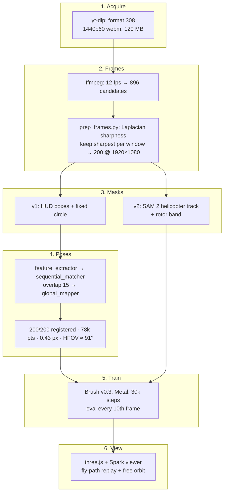

| # | Step | Tool | Output (in the original workspace) |
| --- | --- | --- | --- |
| 1 | Download clip | `yt-dlp` | `video/clip_2m30-3m40.webm` |
| 2 | Extract and pick frames | `ffmpeg`, OpenCV (`script_examples/prep_frames.py`) | `dataset/images/f0000–f0199.jpg` |
| 3a | Masks v1 | `script_examples/prep_frames.py` | `dataset/masks`, `colmap/masks` |
| 4 | Camera poses | COLMAP 4.2.1 (CPU) | `colmap/sparse/0`, `colmap/txt` |
| 5 | Viewer poses | `script_examples/export_poses.py` | `viewer/poses.json` |
| 6 | Train v1 | Brush v0.3.0 | `out/downtown_{10000,20000,30000}.ply` |
| 7 | Viewer | three.js 0.186 + Spark 2.3 | `viewer/index.html` on `localhost:8765` |
| 3b | Masks v2 | SAM 2.1 base+ (`script_examples/sam_heli_masks.py`) | `dataset_v2/masks` |
| 8 | Train v2 | Brush v0.3.0 | `out/v2_{iter}.ply` |

Mask conventions: **Brush** reads a `masks/` folder where **white = keep**. **COLMAP** reads `<image>.png` where **black = ignore**.

---

## 4. Timings and compute (2026-11-22, Apple M5 Pro, 64 GB)

Measured from session logs, local time.

| Step | Wall time | Compute |
| --- | --- | --- |
| Install ffmpeg, COLMAP, Brush, Python env | ~3 min | Downloads only |
| Download 74 s clip at 1440p (120 MB) | ~1.5 min | Network |
| Frames: 896 candidates → 200 sharpest | ~12 s | CPU |
| COLMAP feature extraction | 22 s | CPU |
| COLMAP sequential matching | 48 s | CPU |
| COLMAP global mapper | ~80 s | CPU |
| **Brush training, 30k steps** | **~37 min v1 / ~46 min v2** (10–18 min per 10k; slower with more Gaussians) | **GPU at 100% (Metal)** |
| PyTorch + SAM 2 install, model download (324 MB) | ~5 min | Downloads only |
| SAM 2 tracking of 200 frames | ~1–2 min | GPU (MPS) |

```mermaid
gantt
    title Spike day timeline (local time)
    dateFormat HH:mm
    axisFormat %H:%M
    section Setup
    Installs + download           :15:02, 4m
    Frames + masks v1             :15:06, 1m
    COLMAP poses                  :15:07, 3m
    section Training
    Brush v1 run (killed at ~10k) :crit, 15:09, 11m
    Brush v1 restart (30k)        :15:23, 37m
    section Masks
    Cleanup attempt + static-pixel masks (failed) :16:01, 9m
    SAM 2 install + tracking      :16:10, 12m
    section Training
    Brush v2 run (30k)            :16:22, 46m
```

**Faster alternative:** offload only the training step to a Colab A100/H100 via the official Colab MCP, using gsplat instead of Brush. That's about 8–15 min instead of about 37 min per run, plus 2–5 min of transfers. Worth it for many segments, not for single runs. Details and catches: [scaling-and-tooling.md](scaling-and-tooling.md).

**Total GPU time so far:** about 11 min (killed run) + 37 min (v1) + 46 min (v2) ≈ **1.6 h**, all local, **$0**. Everything before training takes **under 3 minutes** of compute. Training dominates.

The "days" estimates in the plan are calendar time for retries, cleanup and review, not compute.

---

## 5. The propeller problem: what we tried

**Symptom (v1 render):** the skyline looked good, but the centre of the view was streaky and smeared, with dark shards floating in the air and smudges in the sky.

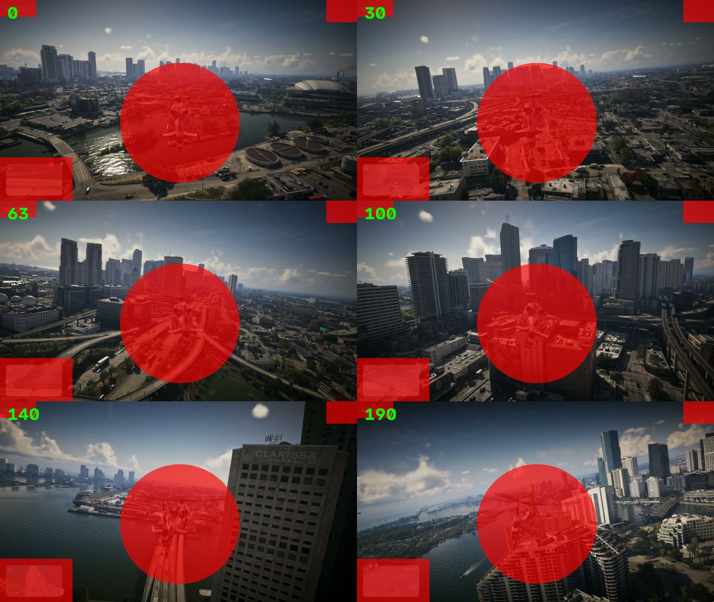

**Diagnosis:**

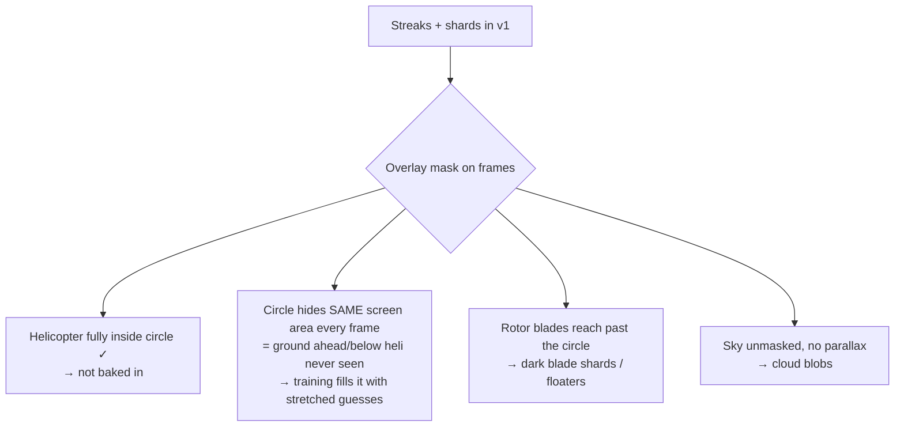

**Attempts:**

| # | Approach | Result | Lesson |
| --- | --- | --- | --- |
| 1 | **Prune after training** (`script_examples/clean_splat.py`): drop near-camera, faint, needle and huge splats | ❌ Worse. The ground went see-through blue, even with moderate settings (74% kept). | Under-observed areas are built from **many faint stacked splats**. Pruning faint ones removes the surface. You can't prune your way out of missing data. |
| 2 | **"Static pixel" masks**: the helicopter is static on screen while the city moves | ❌ Failed. The frames are about 0.3 s apart, and the helicopter shifts and banks too much between them, while flat sky also reads as static. | This needs real object segmentation, not heuristics. |
| 3 | **SAM 2 video segmentation**: one box and point prompt on frame 0, tracked through all 200 frames, plus a thin, nearly level rotor band (tilt clamped to ±15°), dilated about 10 px | ✅ Tight masks with 0 lost frames. The masked area is **28%** of the old circle. | Prompt once and let the video tracker propagate. Blurred rotor blades are hard to segment, so add a geometric band. |
| 4 | **Retrain v2 with the SAM 2 masks** (same COLMAP poses, same Brush settings) | ✅ User verdict: **good enough for Phase 0**. The centre smear and the dark blade shards from v1 are largely gone. Off-path views hold up **in the direction of flight**; views from the far side still streak, since there is no data from there. | The fix had to happen at the **data** level (what training sees), not after training. 1.19M → 1.53M Gaussians: the reclaimed ground got real detail instead of guesses. |
| – | Sky mask | Deferred | Brush's ignore-mask would leave sky floaters unpenalised. A proper fix needs alpha/transparency training or a sky model. |

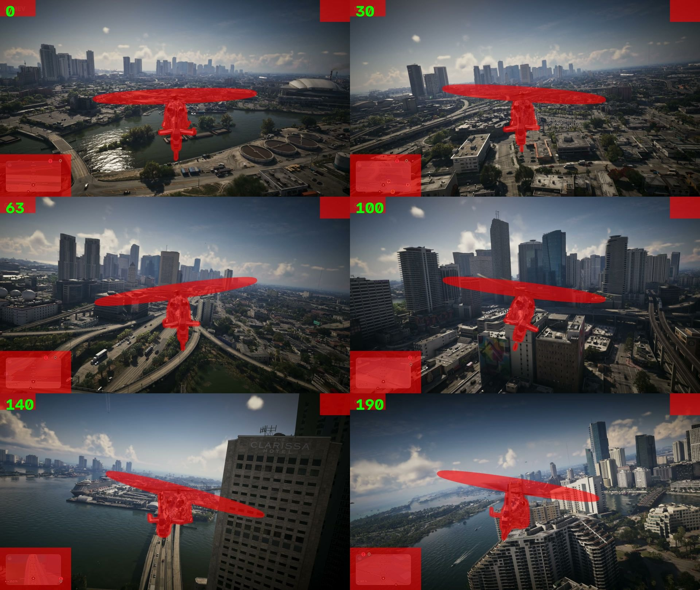

**Before/after SAM 2, same viewer settings, only the masks differ:**

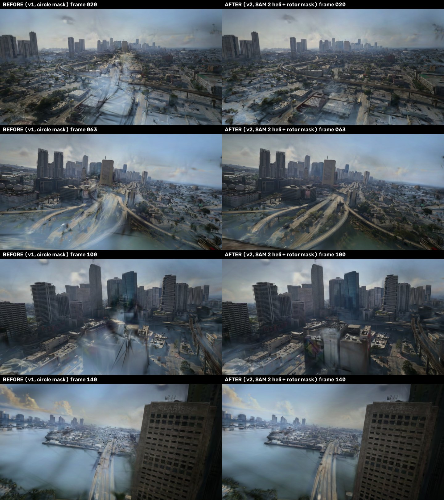

Held-out PSNR (Brush renderer, 20 unseen frames): **v1 24.6 dB → v2 27.2 dB (+2.7 dB)** ([data](../data/heldout_v1_vs_v2.json)). Per-frame pairs: `media/masks/before-after_sam2_*.jpg`.

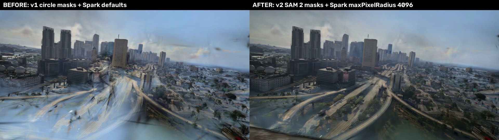

**What SAM 2 resolved, v1 → v2:**

| Issue in v1 | Cause | After SAM 2 masks (v2) |
| --- | --- | --- |
| Streaky smear in the centre of view | Fixed circle hid the ground ahead of/below the heli in every frame | ✅ Largely resolved: masked area down to 28% of the circle, so that ground is now trained |
| Dark blade-like shards floating in the air | Rotor blades reached past the circle and got baked in as floaters | ✅ Resolved: rotor sweep masked with a band in every frame |
| Sky smudges / cloud blobs | Sky unmasked, no parallax | ⏸ Unchanged (deferred) |
| Streaks when viewed from the far side | Single-pass footage: no frames from there | ⏸ Inherent limit; needs more footage (own capture) |

**Tools used for the fix:** SAM 2.1 (`facebookresearch/sam2`, base+ checkpoint), PyTorch 2.15 with MPS on Python 3.15 (separate `.venv-sam`), OpenCV for overlays, dilation and the rotor ellipse.

**Brush masking modes (from its README):**
- A `masks/` folder means *ignore* those pixels: no loss, so anything can grow there.
- An image alpha channel means *force* the splat to match that transparency. The alpha loss doesn't apply in masks mode, so the two don't combine.

---

## 6. Evaluation: held-out metrics and off-path renders

### How we measured
- **Held-out frames:** Brush's `--eval-split-every 10` holds out f0000, f0010, …, f0190 (20 frames) that training never sees.
- **Brush renders:** a dataset with a single `.ply` is used as Brush's starting point. We seeded a copy of `dataset_v2` with `v2_30000.ply` and ran 10 steps with `--start-iter 29990 --eval-every 10 --eval-save-to-disk`. That takes 5 s and writes Brush's own render of every held-out frame.
- **Spark renders:** the viewer drives headless Chrome (`puppeteer-core`, WebGL via Metal; `script_examples/render_eval.mjs`). `window.__shot(pose, offset, yaw)` puts the camera at any training pose with an optional sideways/up offset or yaw. The splat loads once and 20 shots render in about 24 s.
- **Metrics:** PSNR and SSIM against the real frames, **ignoring masked pixels** (HUD, helicopter, rotor) (`script_examples/eval_metrics.py` → [`data/heldout_metrics.json`](../data/heldout_metrics.json)).
- **Scale in metres:** camera height above a fitted ground plane, matched to the HUD altimeter (~300 ft ≈ 91 m), gives **≈ 326 m per scene unit**. Sanity check: ~21 m per frame ≈ 210 km/h, and the 74 s path is ≈ 4.4 km. It's an estimate, good to ±30%.

### Results (v2, 20 held-out frames)
| Renderer | PSNR mean (min–max) | SSIM |
| --- | --- | --- |
| **Brush (reference)** | **27.2 dB** (22.2–32.7) | 0.878 |
| Spark, tuned (`maxPixelRadius: 4096`, `clipXY: 3`) | 23.7 dB (20.2–26.7) | 0.843 |
| Spark, defaults | 19.0 dB (13.6–22.0) | 0.781 |

For reference: about 25–30 dB on held-out views is typical for a good 3DGS scene, and below 20 dB is visibly wrong.

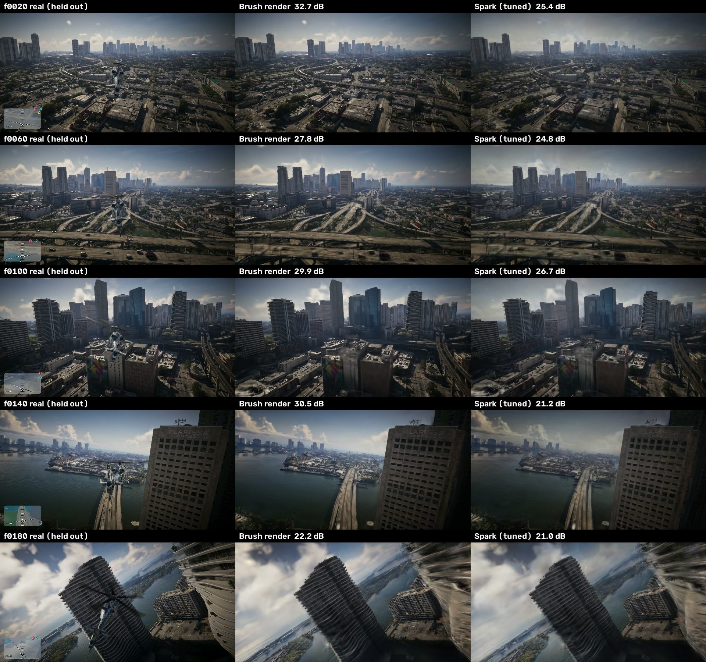

### Key finding: the viewer, not the splat, was hiding the quality
- The splat is good (27 dB on unseen frames, and even the ground under the helicopter is filled in). **Spark's defaults lost about 8 dB**, which made everything we looked at in the viewer worse than the actual splat.
- **Cause:** Spark's `maxPixelRadius` defaults to 512 px and clips the huge splats that make up the sky and background. That left the sky dark or blue (whatever the background was) and the scene washed out. With 4096 px: 18.5 → 23.7 dB. `clipXY` and `maxStdDev` barely matter, and `blurAmount: 0` makes it worse.
- **Remaining ~3.5 dB gap to Brush:** probably Spark's compact, lower-precision splat encoding. Revisit in Phase 4.
- **Coverage check:** rendering on black vs white backgrounds gives per-pixel opacity. With default Spark it was only 73% on a *training* view, which pointed at the renderer.

### Off-path renders (v1 vs v2, frames 63 and 140)
Sheets: [`media/offpath/sheet_offpath_p063.jpg`](../media/offpath/sheet_offpath_p063.jpg), [`media/offpath/sheet_offpath_p140.jpg`](../media/offpath/sheet_offpath_p140.jpg).

| Offset | Result |
| --- | --- |
| 20–50 m right/left of the path | ✅ Skyline and towers hold up; v2 cleaner than v1 in the centre |
| 50 m up | ✅ Holds up, some ground softness |
| Yaw +30° (towards the seen side) | ⚠️ Mostly OK, edges smear |
| Yaw −45° / looking back | ❌ Streaks: no frames from there (single-pass limit) |

This matches the user's visual check: OK in the direction of flight, streaks from the far side.

---

## 7. Limits of single-pass footage

- Views look good only **near the flight line**. Turning more than about 30–45° away shows smears and holes.
- Things always hidden in the same screen area (behind the helicopter) are never reconstructed.
- Building backs are blobby, and the sky becomes floaters.
- Better source: **record our own flight**, in a lawnmower pattern, with the camera about 45° down, in clear weather and with the HUD off. That's better data and avoids third-party rights.

---

## 8. Ecosystem map

GitHub star list: **"3D reconstruction & rendering"**.

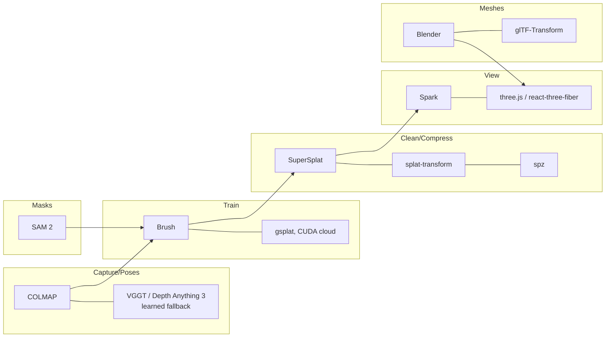

| Tool | Role | Used yet? |
| --- | --- | --- |
| [colmap/colmap](https://github.com/colmap/colmap) | SfM: camera poses + sparse points | ✅ |
| [ArthurBrussee/brush](https://github.com/ArthurBrussee/brush) | Splat trainer (Rust, wgpu/Metal, runs on Mac) | ✅ |
| [facebookresearch/sam2](https://github.com/facebookresearch/sam2) | Video object segmentation (helicopter masks) | ✅ |
| [sparkjsdev/spark](https://github.com/sparkjsdev/spark) | three.js splat renderer (our viewer) | ✅ |
| [playcanvas/supersplat](https://github.com/playcanvas/supersplat) | Manual splat cleanup editor | Next |
| [playcanvas/splat-transform](https://github.com/playcanvas/splat-transform) | Convert and compress splats for the web | Phase 4 |
| [nianticlabs/spz](https://github.com/nianticlabs/spz) | Compressed splat format | Maybe |
| [nerfstudio-project/gsplat](https://github.com/nerfstudio-project/gsplat) | CUDA trainer for cloud quality passes | Maybe |
| [gfx-rs/wgpu](https://github.com/gfx-rs/wgpu) | GPU API that Brush runs on | Indirect |
| [pmndrs/react-three-fiber](https://github.com/pmndrs/react-three-fiber) | React renderer for three.js | Later |
| [blender/blender](https://github.com/blender/blender) | Mesh authoring, `.glb` export (option B) | Later |
| [donmccurdy/glTF-Transform](https://github.com/donmccurdy/glTF-Transform) | Compress `.glb` models | Later |

**Web pipelines:**
- Splats: Brush `.ply` → SuperSplat (cleanup) → splat-transform (`.sog`/`.spz`) → Spark.
- Meshes: Blender → `.glb` → glTF-Transform → three.js / react-three-fiber.

---

## 9. Operational lessons

- **Run long jobs detached** (`nohup … &`). An accidentally closed session killed the first training run at about 10k steps.
- **Brush v0.3 can't resume weights** from a `.ply`. `--start-iter` only changes the step counter, so after a crash you rerun from scratch.
- Brush wrote **nothing to its log** in CLI mode, so there were no PSNR or SSIM numbers. Judge visually, or compute held-out metrics separately.
- Always **overlay masks on sample frames** before training. It catches wrong coordinates (we had a scale bug once) and leaks like rotor tips.
- **Measure, don't just eyeball:** the viewer's default settings made a 27 dB splat look like 19 dB. Always compare against the trainer's own renders before blaming the training data.
- Keep datasets versioned (`dataset/` vs `dataset_v2/`) so runs stay comparable, and reuse COLMAP poses across mask changes.

---

## 10. Outcome

The project was stopped after Phase 0 (go/no-go spike). The pipeline works end to end and the splat scores 27 dB on unseen frames. But **single-pass, single-angle footage can't produce a scene you can freely explore**: views from the far side of buildings streak. Usable results need multi-angle capture (see [next-capture-guide.md](next-capture-guide.md)). All large artifacts (`.ply` files, video, frames, environments) were deleted; sizes are recorded in [results-and-sizes.md](results-and-sizes.md).

## Log
- 2026-11-22: Doc created from the spike session Q&A.
- 2026-11-22: v2 finished at 17:08: 1.53M Gaussians, 46 min.
- 2026-11-22: User visual check of v2: good enough for Phase 0. SAM 2 results documented.
- 2026-11-22: Held-out eval + off-path renders done; Spark maxPixelRadius fix (+5 dB in the viewer).
- 2026-11-22: Project concluded after Phase 0; docs moved into this repo, large artifacts deleted.
