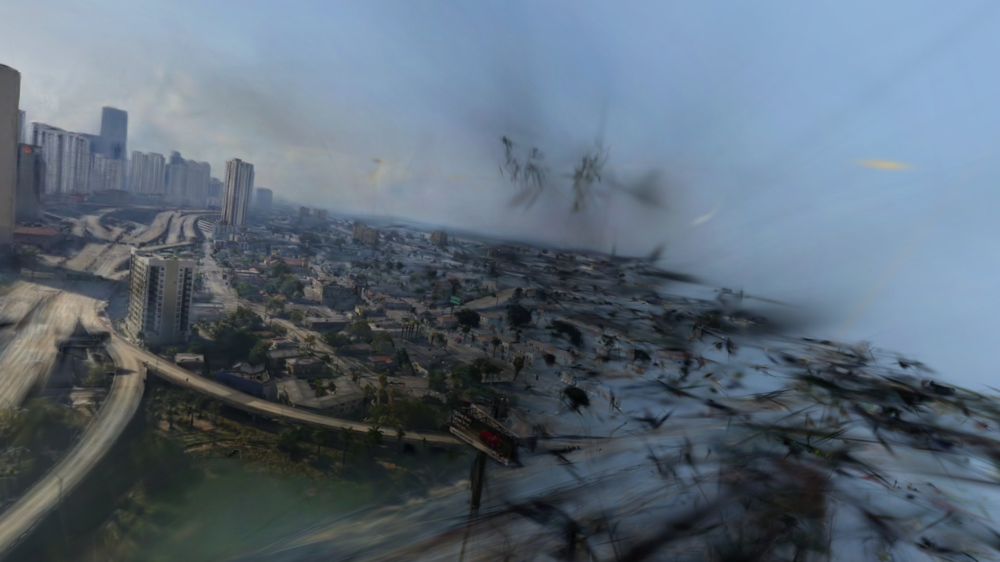

# Next time: capturing footage that gives a usable 3D scene

The single biggest lesson: **reconstruction quality is decided at capture time.** One forward chase-cam pass gave a 27 dB splat that only works near the flight line. Anything never filmed (the far sides of buildings, the ground behind the helicopter) can't be recovered by masks, pruning or more training.

## Flight patterns (aerial / in-game)
| Pattern | What it adds |
| --- | --- |
| **Orbits** around each landmark (full 360°, 2 altitudes, camera aimed at the centre) | Every facade seen from many angles. The most important pattern for buildings |
| **Lawnmower grid** (parallel passes, ~60–70% side overlap, camera ~45° down) | Even coverage of ground and rooftops over an area |
| **Cross-hatch** (grid, then the same grid rotated 90°) | Facades from both directions |
| Several altitudes (low ~50 m, mid ~100 m, high ~200 m) | Detail up close and context from above. Helps registration |
| Slow speed | Sharper frames, more overlap. 210 km/h was fast: about 21 m between sampled frames |

## Camera and game settings
- **Hide the HUD** (no minimap, prompts or watermark), so there's less to mask.
- **No vehicle in frame**: first-person/cockpit camera, or a free/photo-mode camera if the game has one. The helicopter cost us a whole mask iteration and still leaves a blind spot.
- **Clear weather, fixed time of day, no motion blur, no depth of field**, fixed FOV.
- Record at the highest bitrate locally; avoid re-encoded uploads (YouTube compression).
- Keep exposure and lighting stable across a capture. Otherwise use appearance embeddings (gsplat).

## Processing changes for multi-angle footage
- Use COLMAP's **exhaustive or vocabulary-tree matcher** (orbits revisit places), not only sequential.
- Segment by area (one orbit or grid tile per segment), then merge or align.
- Keep the evaluation habit: hold out every 10th frame and compare against the trainer's own renders **before** judging the viewer.
- Mask the sky (or train with alpha) if it produces floaters.

## Rights
Your own capture avoids third-party video rights and YouTube's terms. A navigable 3D copy of a game world is closer to an asset rip than gameplay footage, so host splats outside code repos and check the publisher's policy before publishing.
