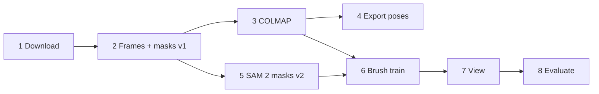

# Pipeline runbook: exact commands

These are the commands as run on 2026-11-22 (macOS, Apple M5 Pro). Paths are relative to a workspace folder. Scripts live in [`../script_examples/`](../script_examples/). Timings are from that run.



## 0. Tools
```bash
brew install ffmpeg colmap yt-dlp            # ffmpeg 9.0.2, COLMAP 4.2.1 (CPU build)
gh release download v0.3.0 -R ArthurBrussee/brush -p 'brush-app-aarch64-apple-darwin.tar.xz*'
shasum -a 256 -c brush-app-aarch64-apple-darwin.tar.xz.sha256 && tar -xf brush-app-aarch64-apple-darwin.tar.xz
python3 -m venv .venv && .venv/bin/pip install opencv-python numpy        # frames, masks, metrics
# SAM 2 (needs Python ≥3.10; we used Homebrew python 3.15, PyTorch 2.15 with MPS):
python3.15 -m venv .venv-sam && .venv-sam/bin/pip install torch torchvision opencv-python-headless \
  "git+https://github.com/facebookresearch/sam2.git"
curl -LO https://dl.fbaipublicfiles.com/segment_anything_2/092824/sam2.1_hiera_base_plus.pt   # 324 MB → models/
npm i puppeteer-core@24                       # headless renders with system Chrome
```

## 1. Download only the segment you need (~1.5 min)
```bash
yt-dlp -f 308 --download-sections "*150-220" -o "video/clip_2m30-3m40.%(ext)s" "<youtube-url>"
# format 308 = 1440p60 VP9 webm (≈120 MB for 74 s). `yt-dlp -F <url>` lists formats.
```

## 2. Frames + v1 masks (~12 s)
```bash
.venv/bin/python -I script_examples/prep_frames.py video/clip_2m30-3m40.webm dataset 200
```
- 12 fps candidates (896), keeps the sharpest (variance of the Laplacian, inside the mask) per window → 200 frames at 1920×1080.
- Writes `dataset/images/fNNNN.jpg`, `dataset/masks/fNNNN.png` (**Brush: white = keep**) and `colmap/masks/fNNNN.jpg.png` (**COLMAP: black = ignore**).
- The HUD boxes are measured on 1280×720 previews. Adjust `BOXES` and the circle for other footage.

## 3. COLMAP camera poses (~2.5 min, CPU)
```bash
colmap feature_extractor --database_path colmap/db.db --image_path dataset/images \
  --ImageReader.mask_path colmap/masks --ImageReader.single_camera 1 \
  --ImageReader.camera_model SIMPLE_RADIAL --FeatureExtraction.use_gpu 0        # 22 s
colmap sequential_matcher --database_path colmap/db.db \
  --SequentialMatching.overlap 15 --FeatureMatching.use_gpu 0                    # 48 s
colmap global_mapper --database_path colmap/db.db --image_path dataset/images \
  --output_path colmap/sparse                                                    # ~80 s
colmap model_analyzer --path colmap/sparse/0      # registered images, points, reprojection error
colmap model_converter --input_path colmap/sparse/0 --output_path colmap/txt --output_type TXT
```
- `single_camera 1`: one lens for the whole video (the game camera's zoom doesn't change).
- `sequential_matcher`: right for video. `global_mapper` (formerly GLOMAP) solves all cameras at once.

## 4. Poses for the web viewer
```bash
.venv/bin/python -I script_examples/export_poses.py colmap/txt     # → viewer/poses.json
```

## 5. v2 masks with SAM 2 (~1–2 min on MPS)
```bash
PYTORCH_ENABLE_MPS_FALLBACK=1 .venv-sam/bin/python script_examples/sam_heli_masks.py preview.jpg
```
- Box + point prompt on frame 0 at the helicopter (coordinates are in the script; read them off a gridded frame). The video predictor tracks it through all frames.
- Adds a thin, nearly level ellipse for the blurred rotor sweep (tilt clamped to ±15°) and dilates about 10 px.
- Writes `dataset_v2/` (images symlinked, `sparse/` copied, new `masks/`). **Always look at `preview.jpg` before training.**

## 6. Train with Brush (~37–46 min, GPU)
```bash
mkdir -p dataset_v2/sparse && cp -r colmap/sparse/0 dataset_v2/sparse/0   # if not already there
nohup ./brush_app dataset_v2 --total-steps 30000 --eval-split-every 10 --eval-every 10000 \
  --export-every 10000 --export-path out --export-name "v2_{iter}.ply" > out/train_v2.log 2>&1 &
```
- **Use `nohup`.** A closed terminal session killed one run. Brush v0.3 can't resume weights (`--start-iter` only changes the step counter).
- `--eval-split-every 10` holds out f0000, f0010, … for evaluation.
- Gaussian growth stops at about 20k steps, so the 20k and 30k files have the same count.

## 7. View
```bash
python3 -m http.server 8765 --bind 127.0.0.1      # from the folder with index.html, poses.json, *.ply
open "http://localhost:8765/?ply=v2_30000.ply"
```
URL options: `&bg=000000` (background colour), `&spark={"maxPixelRadius":512}` (override Spark settings), `&pose=N` (screenshot mode).

## 8. Evaluate
**Brush's own renders of the held-out frames** (5 s). Seed a dataset copy with the trained `.ply` and run 10 steps with eval-to-disk:
```bash
mkdir dataset_v2_eval && ln -s ../dataset/images dataset_v2_eval/images && ln -s ../dataset_v2/masks dataset_v2_eval/masks
cp -r dataset_v2/sparse dataset_v2_eval/sparse && cp out/v2_30000.ply dataset_v2_eval/init.ply
./brush_app dataset_v2_eval --start-iter 29990 --total-steps 30000 --eval-split-every 10 \
  --eval-every 10 --eval-save-to-disk --export-every 100000 --export-path eval/brush
```
**Viewer (Spark) renders** in headless Chrome, plus off-path shots:
```bash
node script_examples/render_eval.mjs v2_30000.ply eval/spark_tuned data/eval_shots.json 000000
node script_examples/render_eval.mjs v2_30000.ply eval/offpath data/offpath_shots.json
.venv/bin/python -I script_examples/eval_metrics.py        # masked PSNR/SSIM + comparison sheets
```
Offsets in `offpath_shots.json` are in scene units. Scale ≈ 326 m/unit, from camera height vs the HUD altimeter.
