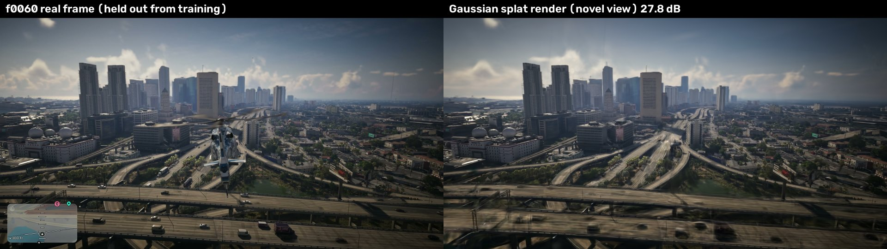
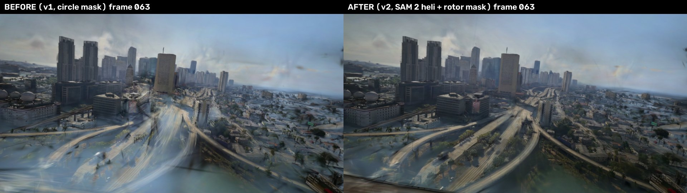
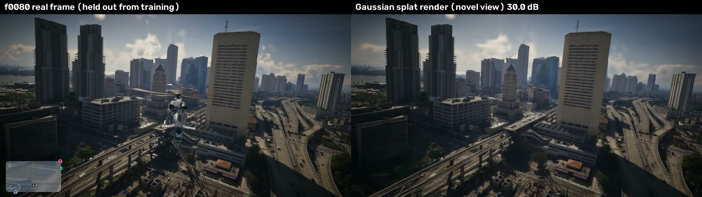
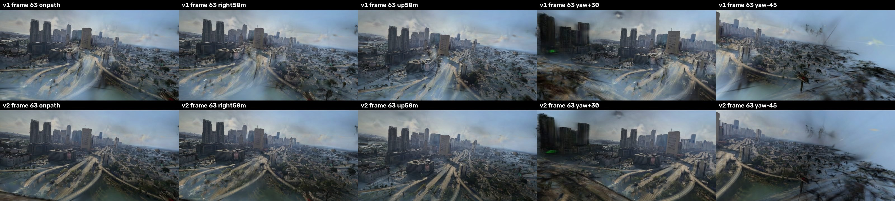
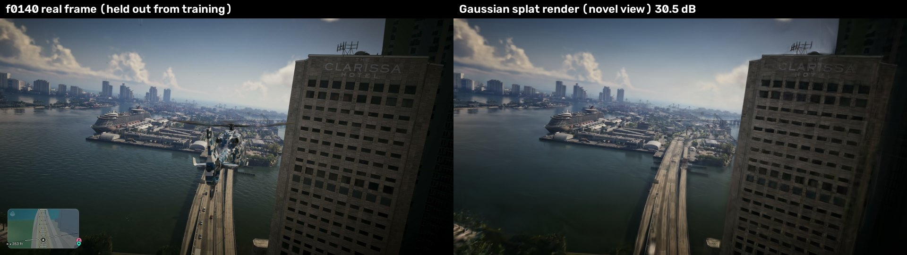

# Results, sizes and why we stopped

Case study: **downtown Vice City and the bay, GTA VI**, reconstructed from 74 seconds of one continuous helicopter flyover (YouTube, GameV, 2:30–3:44). Done on 2026-11-22 on an Apple M5 Pro (64 GB), fully local, $0.

## Headline numbers

| | Value |
| --- | --- |
| Footage used | 74 s at 1440p60 → 200 sharpest frames at 1920×1080 |
| Flight corridor covered | ≈ 4.4 km path at ≈ 91 m altitude (≈ 210 km/h) |
| Camera poses (COLMAP) | **200/200 registered**, 78,389 sparse points, **0.43 px** mean reprojection error, mean track length 5.4 |
| Final splat (v2) | **1,527,578 Gaussians**, **361 MB** `.ply` |
| Held-out quality (20 unseen frames) | **27.2 dB PSNR** (22.2–32.7), SSIM 0.878 (Brush renderer) |
| v1 (circle masks) on the same frames | 24.6 dB PSNR. **SAM 2 masks alone gave +2.7 dB** |
| Same splat in the web viewer (Spark, tuned) | 23.7 dB PSNR, SSIM 0.843 (defaults: 19.0 dB) |
| Total GPU time | ≈ 1.6 h (three training runs) + minutes for eval |
| Calendar time | One afternoon, including two mask iterations |

## Sizes: a dense downtown section

Gaussian splats are heavy. One Gaussian = 59 float32 = **236 bytes** (48 of the 59 numbers are colour, as degree-3 spherical harmonics).

| Artifact | Gaussians | Size |
| --- | --- | --- |
| v1 at 10k steps (circle masks) | 698,705 | 165 MB |
| v1 final (30k) | 1,187,446 | 280 MB |
| v2 at 10k (SAM 2 masks) | 859,142 | 203 MB |
| **v2 final (30k)** | **1,527,578** | **361 MB** |

Better masks gave **+29% Gaussians**: the ground the old mask hid got real detail instead of guesses.

**Rules of thumb from this scene** (dense high-rises + freeways + water, one pass):
- ≈ **350k Gaussians and ≈ 80 MB of raw `.ply` per km** of flight corridor
- ≈ **7,600 Gaussians per training frame** (1.53M / 200)
- Extrapolated to the full usable flight (≈ 6–7 min, ≈ 20–23 km): ≈ **7–8M Gaussians, ≈ 1.7–1.9 GB raw**. That would need segmenting and compression.
- Web compression (splat-transform → `.sog`/`.spz`) typically gives ~10×. Expect **≈ 25–40 MB** for this scene (estimated, not run).

**Workspace footprint** (all deleted at the end):

| Item | Size |
| --- | --- |
| All 7 `.ply` snapshots | 1.8 GB |
| PyTorch + SAM 2 environment | 902 MB |
| Eval renders | 723 MB |
| COLMAP database + model | 374 MB |
| SAM 2.1 base+ checkpoint | 324 MB |
| Source clip | 115 MB |
| 200 frames (JPEG) | 104 MB |
| **Total workspace** | **5.1 GB** |
| Minimum to keep the result + retrain | ≈ 0.5 GB (final `.ply`, frames, masks, poses) |

## What worked
- **The pipeline, end to end**: frames → masks → COLMAP → Brush → web viewer, all local on a Mac in under an hour of compute per iteration.
- **COLMAP on game footage**: perfect registration on the first try. Game graphics have plenty of texture, and the sequential matcher suits video.
- **SAM 2 video tracking** for the helicopter mask: one prompt on frame 0, then tracked through all 200 frames with 0 lost. It removed the rotor-blade shards and the centre smear (+2.7 dB held out):

- **Measuring instead of eyeballing**: held-out PSNR showed the splat was good and the viewer was the problem.

## What didn't
- **Off-path exploration**: fine 20–50 m to the side of the path and in the flight direction. Looking back or around buildings streaks, because nothing was ever filmed from there.
- **Sky**: becomes floaters/haze (no parallax, unmasked).
- **Post-training pruning**: made things worse (see knowledge base §5).
- **Viewer defaults**: Spark's `maxPixelRadius: 512` hid ~5 dB of quality until tuned.

## Why we stopped

The goal was a 3D aerial view people could freely pan and rotate. One forward chase-cam pass only supports views **near the flight line**. Coverage was always going to be a corridor, and the far sides of buildings are simply missing. Scaling up the same footage (Phases 1–4) would give a longer corridor with the same limit.

**A usable result needs multi-angle footage**: orbits around landmarks, parallel passes, several altitudes. See [next-capture-guide.md](next-capture-guide.md). The process, scripts and lessons here carry over directly.

