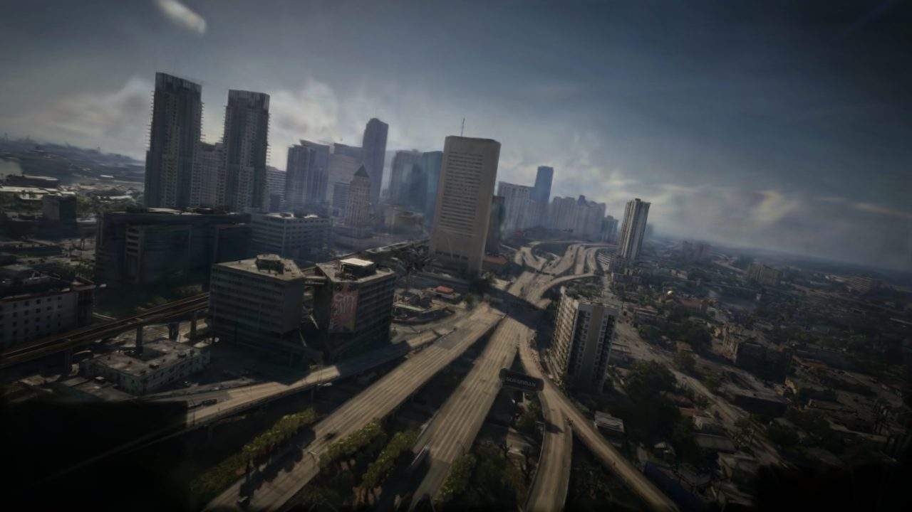

# Web splat clip: 5 seconds of downtown, explorable in the browser

A small, web-ready Gaussian splat of one stretch of the flight: from the freeway interchange with the skyline ahead to the downtown towers (the views in the main README's first images). It was trained only on this section, so all of its detail goes into these 5 seconds.

| File | Size | What |
| --- | --- | --- |
| `clip.spz` | 3.0 MB | 162,914 Gaussians, SPZ v3, SH degree 1 |
| `poses.json` | 18 KB | The 60 real camera poses (three.js axes) that the viewer flies along |
| `index.html` | 9 KB | Embeddable viewer: three.js 0.186 + Spark 2.3 from jsDelivr |
| `poster.jpg` | 85 KB | Shown while the splat loads |
| `clip.mp4` | 397 KB | Fallback: a 5 s render along the path (960×540, H.264) |

**Try it locally:** `python3 -m http.server 8765` in this folder, then open http://localhost:8765/.

**Controls:** it flies back and forth on its own. Drag to look around (±20° left/right, ±10° up/down), scroll or use the slider to move along the path, right-drag (or shift-drag) to drift sideways, space to pause, `r` to reset the view. Rendering stops while it's off screen.

**URL options:** `?base=/path/to/files` (where `clip.spz` and `poses.json` live), `?spz=other.spz`, `?bg=000000`, `?shot=0.5` (screenshot mode, used by `script_examples/render_clip.mjs`).

## How it was made (2026-11-22, about 35 minutes end to end)

| Step | Setting | Result |
| --- | --- | --- |
| Source | GameV's video, 2:54.5–2:59.5 (1440p60) | 5 s, ≈ 290 m of flight |
| Frames | 24 fps candidates, sharpest of each pair | 60 frames at 1920×1080 |
| Masks | HUD boxes (+ a new one for the "DEPLOY LANDING GEAR" prompt), SAM 2.1 helicopter track | 60/60 tracked, 0 lost |
| COLMAP | Same settings as the [runbook](../../docs/pipeline-runbook.md) | **60/60 registered**, 28,825 points, **0.39 px**, track length 9.8 |
| Brush | 20k steps, `--max-splats 600000`, every 10th frame held out | 162,914 Gaussians, 37 MB `.ply`, ≈ 20 min |
| Compress | `splat-transform --spz-version 3 clip_20000.ply -H 1 clip.spz` | 3.0 MB (SH3 would be 4.0 MB and looks the same) |

## Lessons
- **Training time depends on steps, not clip length.** Every step renders one full 1080p frame, so 20k steps took about 20 min for 60 frames. The 10k checkpoint (9 min, 126k Gaussians, 2.3 MB) was already usable.
- **Use a black background.** Brush trains against black, so thin areas (ground at grazing angles, the edges of coverage) end up partly transparent. Any other background colour shows through and looks like washed-out fog.
- **Spark 2.3 can't read SPZ v4**, which is `splat-transform`'s default ("Invalid gzip header"). Pass `--spz-version 3`.
- **Keep the free look tight.** At ±30° the edges show dark streaks where the camera never looked. ±20° stays clean.
